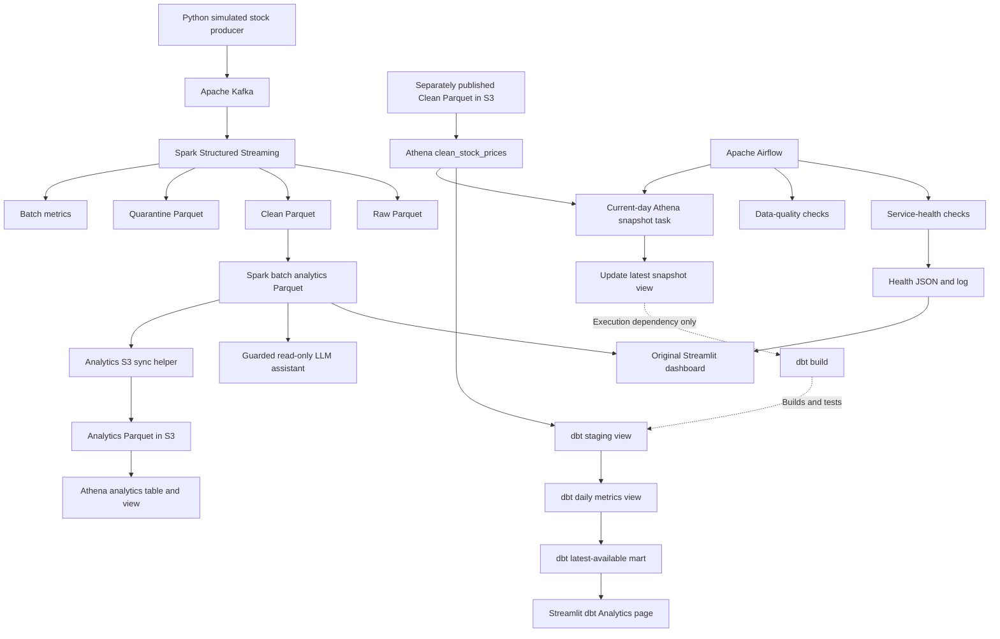
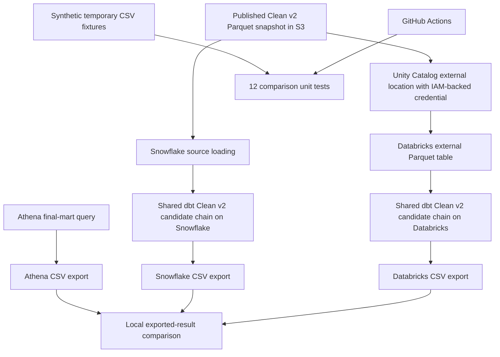
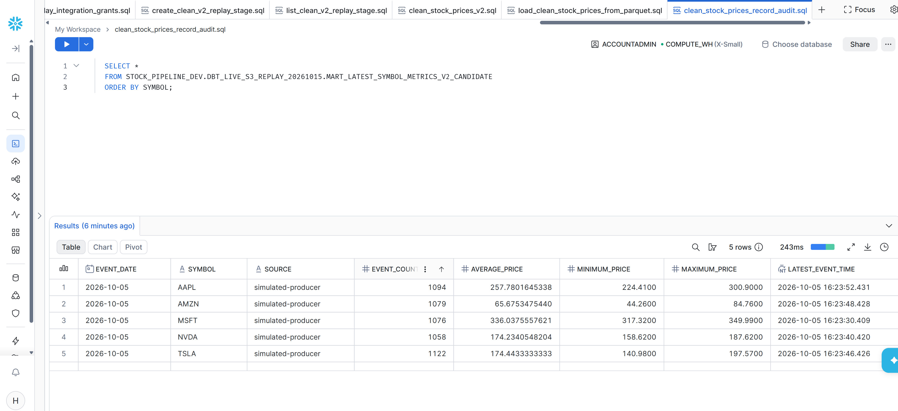

# AI-Assisted Real-Time Stock Analytics Platform

A real-time data platform built with Apache Kafka, Spark Structured Streaming, and AWS, extended with a shared dbt transformation layer validated on Athena, Snowflake, and Databricks.

The platform ingests simulated stock-price events, validates and processes streaming data, retains rejected records for inspection, and produces analytics-ready Parquet datasets. Airflow coordinates operational checks and the Athena/dbt workflow. Streamlit provides dashboard access, while a guarded LLM assistant answers supported questions over curated local analytics.

Warehouse compatibility is demonstrated through synthetic fixtures and S3-backed replay workflows. Additional tooling compares exported final-mart results across three engines, with synthetic-input unit tests run in GitHub Actions.


## Project Scope and Status

| Component | Implemented or validated scope |
|---|---|
| Streaming platform | Kafka event ingestion and Spark micro-batch processing with layered Parquet output |
| Primary cloud analytics | S3-backed Athena queries and an Airflow-orchestrated dbt Core workflow |
| Analytics experience | Original Streamlit dashboard, a separate Athena/dbt Analytics page, and a guarded LLM assistant |
| Snowflake compatibility | Shared Clean v2 model chain validated with synthetic fixtures and a replay from an S3-loaded source |
| Databricks compatibility | Shared Clean v2 model chain validated with synthetic fixtures and a Unity Catalog external-table replay from S3 |
| Export comparison | Five supplied final-mart rows compared across Athena, Snowflake, and Databricks under an explicit tolerance policy |
| Regression testing | Twelve synthetic-input unit tests and a dedicated GitHub Actions workflow |

The real-time component is the Kafka/Spark platform. Snowflake and Databricks are validated replay targets, not continuously scheduled destinations. The project does not claim production-scale performance, availability guarantees, or automated live cross-engine parity.

All stock-price events are simulated. Results are engineering validation samples, not a live exchange feed or investment signal.

## Contents

- [Key Features](#key-features)
- [Demo](#demo)
- [Architecture](#architecture)
- [Data Layers and Analytics Models](#data-layers-and-analytics-models)
- [Tech Stack](#tech-stack)
- [Run Locally](#run-locally)
- [Orchestration and Monitoring](#orchestration-and-monitoring)
- [dbt Analytics on Athena](#dbt-analytics-on-athena)
- [Warehouse Portability and Replay Validation](#warehouse-portability-and-replay-validation)
- [Cross-Engine Export Comparison](#cross-engine-export-comparison)
- [Testing and Continuous Integration](#testing-and-continuous-integration)
- [Engineering Decisions](#engineering-decisions)
- [Project Structure](#project-structure)
- [Optional Google BigQuery Export](#optional-google-bigquery-export)
- [Configuration and Publication Boundaries](#configuration-and-publication-boundaries)
- [Documentation and Evidence](#documentation-and-evidence)
- [License](#license)

## Key Features

- Streaming ingestion: a Python producer publishes simulated events to Kafka; Spark processes micro-batches every 10 seconds.
- Data-quality controls: required-field validation, Kafka-offset-based deduplication, and quarantine records with explicit rejection reasons.
- Layered storage: raw, clean, quarantine, metrics, analytics, and monitoring outputs remain separate.
- Cloud analytics: Athena queries S3-backed Parquet, with dbt staging, daily metrics, and latest-available mart views.
- Orchestration: Airflow schedules quality checks, service-health checks, Athena snapshots, and dbt builds.
- Analytics access: Streamlit presents pipeline health, stock summaries, and a dedicated Athena/dbt page.
- Guarded natural-language analytics: an LLM assistant routes supported questions to read-only local analytics lookups.
- Warehouse portability: shared dbt transformation models support Snowflake and Databricks through platform-aware source mappings and timestamp parsing.
- Replay evidence: Snowflake validates an S3-loaded source; Databricks validates external Parquet access through Unity Catalog.
- Repeatable validation: a CSV comparison script uses explicit numeric tolerance; twelve unit tests exercise matching and failure cases in CI.

## Demo

### Natural-language analytics

> User: Show latest prices for AAPL, MSFT, and NVDA.
>
> Assistant: Returns the latest available prices, event timestamps, and processed tick counts from curated Analytics Parquet.


The assistant uses allowlisted query patterns. It is not an unrestricted SQL agent and cannot modify data, control infrastructure, or provide financial advice.

Supported examples:

```text
Summarize the latest pipeline output
What is the latest price for AAPL?
Show latest prices for AAPL, MSFT, and NVDA
Give me AAPL summary for 2026-09-15
```


### Pipeline observability

The dashboard presents service-health status, analytics freshness, symbol-level prices, summary metrics, and processed-tick coverage. Historical sample results are not presented as current market data.

## Architecture

### Core platform and primary Athena workflow



The two Athena paths are distinct. The Analytics sync helper publishes Spark Analytics Parquet; the dbt workflow reads the registered Clean source. The diagram does not imply that the helper also publishes Clean data.

The Airflow snapshot/view tasks precede the dbt task, but the dbt source is `clean_stock_prices`, not the snapshot view. This is an execution dependency, not a source-data dependency.

### Warehouse replays and validation tooling



The replay branches were manually executed validations. The diagram does not establish continuous ingestion, scheduled Snowflake/Databricks jobs, or independently verified source identity across the three compared queries.

GitHub Actions runs the synthetic unit tests. It does not query the warehouses or read the ignored local CSV exports.

See [ARCHITECTURE.md](ARCHITECTURE.md) for the separate architecture document. The diagrams above describe the scope summarized in this README.

## Data Layers and Analytics Models

| Layer | Location | Purpose |
|---|---|---|
| Raw | `data/raw/stock_prices` | Retained Kafka payloads and ingestion metadata |
| Clean | `data/clean/stock_prices` | Validated, deduplicated events partitioned by event date |
| Quarantine | `data/quarantine/stock_prices` | Invalid events with rejection context |
| Metrics | `data/metrics/stream_batches` | Raw, clean, and quarantine counts per micro-batch |
| Analytics | `data/analytics/stock_price_summary` | Daily summaries by event date, symbol, and source |
| Monitoring | `data/monitoring` | Health JSON and append-only health log |
| Published replay snapshot | S3 prefix ending in `replay/snowflake-clean-v2-20261015/` | Parquet input location used in replay work |
| Databricks replay namespace | `workspace.clean_live_s3_replay_20261015` | External source table and candidate views |

The `snowflake` segment in the snapshot prefix is a publication name, not a restriction on which engine can read the Parquet objects.

### Spark analytics output

The batch analytics job groups events by:

```text
event_date, symbol, source
```

Its summaries contain:

```text
tick_count
min_price
max_price
avg_price
latest_price
first_event_time
last_event_time
processed_at
```

### dbt mart output

The dbt mart is a separate interface:

```text
event_date
symbol
source
event_count
average_price
minimum_price
maximum_price
latest_event_time
```

It reports captured-event metrics and the latest event timestamp. It does not expose a latest observed price or claim complete market-session OHLC coverage. Each symbol/source pair can have a different latest available date; query time is not event time.

## Tech Stack

| Layer | Technology | Purpose |
|---|---|---|
| Producer | Python | Simulated stock-price events |
| Event transport | Apache Kafka | Streaming through `pipeline-events` |
| Processing | Apache Spark 3.5 | Streaming validation, deduplication, Parquet output, and batch analytics |
| Storage | Apache Parquet and Amazon S3 | Local layered datasets and cloud query/replay inputs |
| Orchestration | Apache Airflow 2.7 | Quality checks, health checks, Athena refresh, and dbt execution |
| Metadata | PostgreSQL 14 | Airflow metadata |
| Primary query engine | Amazon Athena | Queries over S3-backed data |
| Transformations | dbt Core and adapters | Shared models and warehouse data tests |
| Warehouse validation | Snowflake | Synthetic fixtures and S3-loaded source replay |
| Lakehouse validation | Databricks SQL and Unity Catalog | Synthetic fixtures and external Parquet replay |
| Access control | AWS IAM | Cloud access, including the Databricks replay role |
| User interface | Streamlit | Original dashboard and dedicated Athena/dbt page |
| Natural-language interface | OpenAI API | Allowlisted analytics question routing |
| Local deployment | Docker Compose | Multi-service development environment |
| Comparison tests | Python standard library | CSV validation and synthetic-input unit tests |
| CI | GitHub Actions | Comparison unit-test execution |
| Optional export | Google BigQuery and Looker Studio | Secondary warehouse/reporting path |

Versions above describe the documented project configuration, not a claim that these are the latest releases. Replay-specific adapter versions are recorded separately below and in validation records.

## Run Locally

### Prerequisites

- Docker Desktop with Docker Compose.
- Python for local helper scripts and comparison tooling; the documented dbt environments use Python 3.11.
- A local `.env` file containing the configuration required by your Compose services.
- An OpenAI API key when using the LLM assistant.
- AWS configuration when using S3/Athena features.

Cloud warehouse replays additionally require the relevant adapter, account access, source configuration, and warehouse resources. Databricks external-table replay requires Unity Catalog access and a configured external location.

Never commit the local `.env` file or secret-bearing credentials.

### 1. Start the stack

From the repository root:

```powershell
docker compose up -d
docker compose ps
```

For the custom Airflow/dbt image, build before starting or after image changes:

```powershell
docker compose build airflow-scheduler
docker compose up -d
```

Expected core services include:

```text
airflow
airflow-scheduler
broker
postgres
spark-master
spark-worker
stock-producer
pipeline-dashboard
```

### 2. Start streaming

```powershell
.\start_stream.ps1
```

The job consumes Kafka events and writes raw, clean, quarantine, metrics, and checkpoint output under `data/`.

### 3. Build batch analytics

After Clean events exist:

```powershell
docker exec -it spark-master /opt/spark/bin/spark-submit `
  --master spark://spark-master:7077 `
  /opt/spark-apps/build_analytics_layer.py
```

### 4. Open local interfaces

| Service | URL |
|---|---|
| Airflow | `http://localhost:8080` |
| Spark Master UI | `http://localhost:8081` |
| Streamlit | `http://localhost:8501` |

### 5. Verify health output

Trigger `pipeline_health_check` in Airflow, or wait for its configured schedule:

```powershell
Get-Content .\data\monitoring\pipeline_status.json
Get-Content .\data\monitoring\pipeline_health.log -Tail 5
```

A healthy sample includes:

```json
{
  "status": "healthy",
  "errors_seen": []
}
```

### 6. Publish Analytics Parquet when using Athena

```powershell
.\sync_to_s3.ps1
```

This helper supports the original Analytics publication path. It does not replace separate Clean-source publication or warehouse replay setup.

## Orchestration and Monitoring

| DAG | Documented schedule | Responsibility |
|---|---|---|
| `pipeline_data_quality_check` | Every 5 minutes | Pipeline data-quality checks |
| `pipeline_health_check` | Every 5 minutes | Kafka, Spark Master, and PostgreSQL connectivity |
| `refresh_athena_analytics` | Every 30 minutes | Current-day snapshot, latest snapshot view update, and dbt build |

Schedules execute only while the relevant DAGs and Airflow scheduler are enabled and healthy. Replay work is separate from these scheduled tasks.

The Athena/dbt DAG permits two retries with a one-minute delay; its dbt task has a ten-minute execution timeout. Other DAGs retain their own retry settings.

```text
data/monitoring/
├── pipeline_status.json
└── pipeline_health.log
```

The JSON file is the latest machine-readable health snapshot; the log retains append-only history.


Rejected events are retained rather than silently dropped. The recorded quarantine example contains an intentionally invalid `AAPL` event with `price = -25.5` and `validation_error = non_positive_price`.


See [MONITORING.md](MONITORING.md) and [RUNBOOK.md](RUNBOOK.md) for operational guidance.

## dbt Analytics on Athena

The primary scheduled dbt Core workflow reads `realtime_pipeline.clean_stock_prices`, an existing S3-backed Athena source. dbt does not ingest Kafka events, upload local Clean files, or replace Spark.

| Model | Materialization | Purpose |
|---|---|---|
| `stg_stock_prices` | View | Event-level normalization and retained Kafka metadata |
| `int_daily_symbol_metrics` | View | Daily captured-event metrics by date, symbol, and source |
| `mart_latest_symbol_metrics` | View | Latest available daily metrics per symbol/source |

### Execution order

```text
refresh_daily_symbol_metrics
    → update_latest_metrics_view
    → dbt_build_analytics
```

The first task creates a current-day Parquet snapshot from `clean_stock_prices`; the second updates `v_latest_daily_symbol_metrics`; the third builds/tests dbt views. The dbt models still read `clean_stock_prices`, not the snapshot view.

### Profile and commands

The Airflow image installs dbt in `/opt/dbt-venv`, separate from Airflow packages.

Create the ignored local file `dbt/profiles/profiles.yml`:

```yaml
stock_analytics:
  target: dev
  outputs:
    dev:
      type: athena
      database: awsdatacatalog
      schema: "{{ env_var('ATHENA_DATABASE') }}"
      region_name: "{{ env_var('AWS_REGION') }}"
      s3_staging_dir: "{{ env_var('ATHENA_OUTPUT') }}"
      threads: 2
```

Provide the referenced environment variables and an AWS identity with appropriate Athena, S3, and Glue permissions through local configuration.

```powershell
docker compose exec -e DBT_LOG_PATH=/tmp/dbt-logs -e DBT_TARGET_PATH=/tmp/dbt-target airflow-scheduler /opt/dbt-venv/bin/dbt build --project-dir /opt/airflow/dbt --profiles-dir /opt/airflow/dbt/profiles
```

Generate dbt documentation:

```powershell
docker compose exec -e DBT_LOG_PATH=/tmp/dbt-docs-logs -e DBT_TARGET_PATH=/tmp/dbt-docs airflow-scheduler /opt/dbt-venv/bin/dbt docs generate --project-dir /opt/airflow/dbt --profiles-dir /opt/airflow/dbt/profiles
```

Documentation generation was validated on October 7, 2026. Its `index.html`, `manifest.json`, and `catalog.json` output under `/tmp/dbt-docs` is temporary container output; regenerate after container replacement and review metadata before publication.

### Dashboard boundaries

| Interface | Data source |
|---|---|
| Original Streamlit dashboard | Local Analytics Parquet and monitoring artifacts |
| dbt Analytics page | Fixed read-only Athena query against `mart_latest_symbol_metrics` |
| LLM assistant | Allowlisted lookups over local Analytics Parquet |
| Snowflake and Databricks replays | SQL/dbt validation; no warehouse-backed dashboard or assistant integration claimed |

The dbt page caches results for five minutes and displays event timestamps, result-fetch time, and an Athena query ID.


The October 7 validation displayed 1,497 simulated events across five symbols with an event date of September 4, 2026. This is a different sample from the 5,429-event export comparison below, not a throughput or freshness benchmark.

The original Analytics publication path remains available separately:

```text
Clean Parquet → Spark Analytics Parquet → S3 → Athena analytics view
```


## Warehouse Portability and Replay Validation

The shared Clean v2 chain is:

```text
Clean v2 source
    → stg_stock_prices_v2_candidate
    → int_daily_symbol_metrics_v2_candidate
    → mart_latest_symbol_metrics_v2_candidate
```

Platform-aware source mappings and adapter-dispatched timestamp parsing allow reuse of the transformation chain without separate copies of the three models.

Runs opt in with `use_clean_stock_prices_v2: true`. The legacy branch remains the default.

### Synthetic-fixture validation

Equivalent six-row fixtures were executed on Snowflake and Databricks. Independent fixture replays were performed on October 14, 2026 in isolated schemas.

| Original fixture validation | Snowflake | Databricks |
|---|---|---|
| dbt Core | 1.12.5 | 1.12.0 |
| Adapter | dbt-snowflake 1.12.1 | dbt-databricks 1.12.4 |
| Candidate views | 3 | 3 |
| Data tests passed | 18 | 18 |
| Combined result | `PASS=21 ERROR=0 SKIP=0` | `PASS=21 ERROR=0 SKIP=0` |

The fixture results establish transformation portability, not cloud-source ingestion. Separate Python 3.11 dependency snapshots are retained under `dbt/requirements/`. Both Airflow v2 DAGs remained paused during the documented original fixture validation and independent fixture replay work.

- [Original portability validation](docs/warehouse-portability-validation.md)
- [Independent fixture replay](docs/warehouse-portability-replay-20261014.md)
- [Snowflake fixture](dbt/fixtures/snowflake-clean-v2.sql)
- [Databricks fixture](dbt/fixtures/databricks-clean-v2.sql)
- [Snowflake replay fixture](dbt/fixtures/snowflake-clean-v2-replay-20261014.sql)
- [Databricks replay fixture](dbt/fixtures/databricks-clean-v2-replay-20261014.sql)

### Snowflake replay from an S3-loaded source

The subsequent Snowflake replay validated this path:

```text
Published Clean v2 Parquet in S3
    → Snowflake source loading
    → shared dbt Clean v2 candidate chain
    → model and data-test validation
    → final-mart query
```

The replay procedure and saved execution evidence are recorded in [Snowflake Clean v2 replay](docs/snowflake-clean-v2-live-s3-replay-20261015.md).

This is a replay from an S3-loaded source, not a claim of continuous ingestion or scheduled Snowflake execution. Refer to the replay record for its execution details rather than inferring results from the fixture-validation counts.



### Databricks direct S3 snapshot replay

On October 16, 2026, Databricks read published Clean v2 Parquet through a Unity Catalog external table. The `20261015` suffix identifies the snapshot and namespace, not the execution date.

| Setting | Validated configuration |
|---|---|
| Catalog | `workspace` |
| Source and output schema | `clean_live_s3_replay_20261015` |
| External location | `s3-replay-20261015` |
| Source table | `clean_stock_prices_v2` |
| Source format | Parquet |
| dbt authentication | Interactive OAuth |
| dbt Core | 1.12.5 |
| dbt-databricks | 1.12.7 |
| Candidate views built | 3 |
| Data tests passed | 18 |

The external location uses a Unity Catalog storage credential backed by an AWS IAM role. Credential names are environment-specific.

The setup record reports successful storage and role-access checks. Optional file-events permission validation did not pass; this project does not claim file-events-based ingestion.

Inspect the external source without recreating it:

```sql
DESCRIBE EXTENDED
workspace.clean_live_s3_replay_20261015.clean_stock_prices_v2;
```

Source diagnostic:

```sql
SELECT
    COUNT(*) AS row_count,
    COUNT(DISTINCT kafka_offset) AS distinct_offsets
FROM workspace.clean_live_s3_replay_20261015.clean_stock_prices_v2;
```

Distinct offsets alone are not a full Kafka identity check: event identity includes topic, partition, and offset.

Configure a local, ignored Databricks profile with the documented structure:

```yaml
stock_analytics:
  target: databricks_replay
  outputs:
    databricks_replay:
      type: databricks
      catalog: workspace
      schema: CLEAN_LIVE_S3_REPLAY_20261015
      host: "<your-databricks-workspace-host>"
      http_path: "<your-sql-warehouse-http-path>"
      auth_type: oauth
      threads: 1
```

Run from the repository root in the Databricks adapter environment:

```powershell
$env:DBT_SOURCE_DATABASE = "workspace"
$env:DBT_SOURCE_SCHEMA = "clean_live_s3_replay_20261015"

dbt debug `
  --project-dir dbt `
  --profiles-dir dbt\profiles_databricks_replay_20261014

dbt run `
  --project-dir dbt `
  --profiles-dir dbt\profiles_databricks_replay_20261014 `
  --vars '{"use_clean_stock_prices_v2": true}'

dbt test `
  --project-dir dbt `
  --profiles-dir dbt\profiles_databricks_replay_20261014 `
  --vars '{"use_clean_stock_prices_v2": true}'
```

The ignored profile directory must be created locally; it is not provided by a fresh clone. Its retained `20261014` name does not determine the destination schema. The active profile must target `CLEAN_LIVE_S3_REPLAY_20261015`; source environment variables independently select the input table location.

The successful separate commands reported:

```text
dbt run:  PASS=3  WARN=0 ERROR=0 SKIP=0
dbt test: PASS=18 WARN=0 ERROR=0 SKIP=0
```

Inspect the final mart:

```sql
SELECT *
FROM workspace.clean_live_s3_replay_20261015.mart_latest_symbol_metrics_v2_candidate
ORDER BY event_date, symbol, source;
```


Full setup and execution screenshots remain in [Databricks replay evidence](docs/screenshots/20261015_databricks_s3_replay/), including external-location configuration, source metadata, source counts, profile configuration, model execution, tests, and candidate views.

## Cross-Engine Export Comparison

On October 16, 2026, five supplied final-mart rows for event date `2026-10-05` and source `simulated-producer` were compared across Athena, Snowflake, and Databricks. The manual review was followed by a repeatable local CSV comparison.

| Symbol | Event count in each supplied export | Minimum price | Maximum price |
|---|---:|---:|---:|
| AAPL | 1094 | 224.41 | 300.90 |
| AMZN | 1079 | 44.26 | 84.76 |
| MSFT | 1076 | 317.32 | 349.99 |
| NVDA | 1058 | 158.62 | 187.62 |
| TSLA | 1122 | 140.98 | 197.57 |

Each export contained five mart rows representing 5,429 events, calculated by summing `event_count`. This is a sample count, not a production throughput measurement.

### Comparison policy

- Normalize header casing and trim surrounding field whitespace.
- Reject unexpected or duplicate columns, malformed rows, empty fields, empty results, and duplicate grouping keys.
- Align rows by `(event_date, symbol, source)` and detect missing or extra keys.
- Compare event counts and minimum/maximum prices numerically using decimal arithmetic.
- Compare average prices with an absolute tolerance of `1E-10`.
- Compare timestamp wall-clock values after parsing their supplied representations.

The timestamp check deliberately removes timezone information for wall-clock comparison. It does not normalize all values to UTC or establish equality of instants.

### Observed result

```text
athena: 5 rows; total event_count = 5429
snowflake: 5 rows; total event_count = 5429
databricks: 5 rows; total event_count = 5429
snowflake vs athena: maximum average-price difference = 3.338E-11
databricks vs athena: maximum average-price difference = 0

Average-price absolute tolerance: 1E-10
Timestamp check: wall-clock values only; timezone parity NOT verified.
Source snapshot identity and full-result completeness NOT verified.

RESULT: PASS for supplied exports under the stated comparison policy
```

The numeric tolerance is an explicit policy for this check, not an exact-equality claim or a universal financial-data tolerance.

### Run the comparison

Download original query-result CSVs and place them locally at:

```text
tests/cross_engine/local_exports/
├── athena.csv
├── snowflake.csv
└── databricks.csv
```

This directory is Git-ignored and is not populated by a fresh clone. Preserve full exported precision and timestamps; avoid spreadsheet reformatting or resaving before validation.

```powershell
python .\tests\cross_engine\compare_exports.py
```

The script compares files only. It does not execute warehouse queries, verify query provenance, or confirm that the same S3 objects were read by each engine.

See the original [manual comparison record](docs/clean-v2-cross-engine-manual-comparison-20261016.md). That document records the manual evidence stage; the script and unit tests implement the subsequent repeatable check.

## Testing and Continuous Integration

### Comparison unit tests

Run without cloud credentials, Docker, or local warehouse exports:

```powershell
python .\tests\cross_engine\test_compare_exports.py
```

The validated run completed twelve tests successfully. Synthetic temporary CSVs exercise:

- Matching exports.
- Uppercase headers.
- Equivalent numeric formatting.
- Average differences inside and outside tolerance.
- Event-count differences.
- Missing and extra keys.
- Duplicate keys.
- Empty exports.
- Equivalent timestamp display formats.
- Different timestamp wall-clock values.

These tests protect specific checker behaviors; they do not prove exhaustive coverage of every malformed input or every warehouse semantic difference.

### GitHub Actions

The [Clean v2 comparison workflow](.github/workflows/clean-v2-comparison-tests.yml) runs the synthetic unit tests for relevant pull requests and pushes to `main`, and supports manual dispatch.

The final workflow configuration uses:

```text
Runner: ubuntu-24.04
Python: 3.11
Checkout: actions/checkout@v6
Python setup: actions/setup-python@v6
```

CI requires no cloud credentials or local exports and does not execute live parity checks. A successful Actions run was observed during workflow validation; consult the repository Actions tab for current status.

### Other project tests

Run the broader Python suite in an environment with its required dependencies:

```powershell
python -m pytest tests -v
```

This broader command is separate from the dedicated CI job above; its inclusion here does not claim a newly verified full-suite pass.

Run the Spark smoke test in the running stack:

```powershell
docker exec -it spark-master /opt/spark/bin/spark-submit `
  --master spark://spark-master:7077 `
  /opt/spark-apps/smoke_test.py
```

### dbt validation counts

| Recorded validation scope | Models | Data tests | Interpretation |
|---|---:|---:|---|
| Original Athena analytics | 3 | 14 | 17 successful resources in a combined build |
| Clean v2 fixture portability | 3 | 18 | 21 successful resources in a combined build |
| Databricks external-table replay | 3 | 18 | Separate `PASS=3` model and `PASS=18` test summaries |

The twelve Python unit tests are separate from the dbt data tests. Do not combine these into a single warehouse-validation count.

### Operational checklist

- Docker services are running.
- Spark is consuming events and writing layered output.
- Invalid records have explicit quarantine reasons.
- Relevant Airflow DAGs complete successfully when enabled.
- Health JSON reports the observed service state.
- Athena can query the configured S3-backed datasets.
- Streamlit shows the intended data source and timestamps.
- The assistant answers allowlisted questions only.

## Engineering Decisions

- Layered storage preserves traceability while separating accepted data, rejected records, analytics, and operational state.
- Kafka topic, partition, and offset provide the stream event identity used for deduplication; business-event uniqueness across arbitrary replays is a separate concern.
- Event-date partitioning supports partition-aware processing and queries.
- Quarantine preserves rejected events with actionable error context.
- Airflow separates quality checks, infrastructure health, and Athena refresh responsibilities.
- dbt Core runs in an isolated environment inside the Airflow image to separate adapter dependencies from Airflow packages.
- Shared transformations use adapter-aware parsing and source mappings instead of maintaining three independent model implementations.
- Clean v2 is explicitly enabled; the legacy source branch remains available by default.
- Warehouse replay namespaces isolate validation outputs from earlier fixtures.
- The original dashboard, Athena/dbt page, and LLM assistant retain distinct data-source boundaries.
- Decimal-based export comparison uses a stated tolerance instead of silently rounding source data.
- Synthetic unit tests run without production data or cloud credentials.
- Optional BigQuery utilities remain a secondary integration rather than a required dependency of the core platform.

## Project Structure

Selected tracked files and directories are shown below. This is a navigational overview, not an exhaustive repository inventory.

```text
Real-Time-Data-Engineering-Pipeline/
├── .github/
│   └── workflows/
│       └── clean-v2-comparison-tests.yml
├── airflow/
│   ├── Dockerfile.dbt
│   └── dags/
│       ├── pipeline_data_quality_check.py
│       ├── pipeline_health_check.py
│       └── refresh_athena_analytics.py
├── dashboard/
│   ├── app.py
│   └── pages/
│       ├── 1_Pipeline_Analytics_Assistant.py
│       └── 1_dbt_Analytics.py
├── data/
│   └── monitoring/
│       └── .gitkeep
├── dbt/
│   ├── dbt_project.yml
│   ├── fixtures/
│   │   ├── snowflake-clean-v2.sql
│   │   ├── databricks-clean-v2.sql
│   │   ├── snowflake-clean-v2-replay-20261014.sql
│   │   └── databricks-clean-v2-replay-20261014.sql
│   ├── macros/
│   ├── models/
│   │   ├── sources.yml
│   │   ├── staging/
│   │   ├── intermediate/
│   │   └── marts/
│   ├── profile_examples/
│   │   ├── snowflake/
│   │   └── databricks/
│   ├── profiles_snowflake_live_s3_replay_20261015/
│   │   └── profiles.yml
│   ├── requirements/
│   └── tests/
├── docs/
│   ├── clean-v2-cross-engine-manual-comparison-20261016.md
│   ├── snowflake-clean-v2-live-s3-replay-20261015.md
│   ├── warehouse-portability-validation.md
│   ├── warehouse-portability-replay-20261014.md
│   └── screenshots/
│       └── 20261015_databricks_s3_replay/
├── gcp/
│   ├── README.md
│   ├── export_events_to_bigquery.py
│   └── export_metrics_to_bigquery.py
├── images/
├── llm/
│   ├── __init__.py
│   ├── analytics_backend.py
│   ├── assistant.py
│   └── demo.py
├── producer/
│   ├── requirements.txt
│   └── stock_producer.py
├── scripts/
├── spark/
│   └── jobs/
│       ├── build_analytics_layer.py
│       ├── kafka_stream.py
│       └── smoke_test.py
├── src/
├── tests/
│   └── cross_engine/
│       ├── compare_exports.py
│       └── test_compare_exports.py
├── utils/
├── .gitignore
├── ARCHITECTURE.md
├── docker-compose.yml
├── LICENSE.txt
├── MONITORING.md
├── README.md
├── RUNBOOK.md
├── requirements-dev.txt
├── run_health_check.ps1
├── start_stream.ps1
└── sync_to_s3.ps1
```

Local runtime datasets, comparison exports, logs, environments, and active ignored profiles are intentionally omitted from this tracked-files overview. Their presence on a developer machine is not evidence that they are committed.

## Optional Google BigQuery Export

The optional `gcp/` path demonstrates secondary cloud warehouse/reporting integration. It is not required for the primary Spark/S3/Athena/dbt workflow.

| Script | Documented output |
|---|---|
| `gcp/export_events_to_bigquery.py` | `realtime_pipeline.events` |
| `gcp/export_metrics_to_bigquery.py` | `realtime_pipeline.metrics` |

Historical evidence also includes a `realtime_pipeline.source_metrics` query with source-level counts and revenue metrics. That supporting artifact is distinct from the stock-price mart and does not establish that the current metrics exporter writes that table.

- [BigQuery event evidence](images/bigquery-events.png)
- [Supporting BigQuery metrics evidence](images/bigquery-metrics.png)
- [Looker Studio exploration](images/looker-studio-dashboard.png)
- [Optional export setup](gcp/README.md)

## Configuration and Publication Boundaries

- Supply passwords, tokens, API keys, and AWS credentials through local configuration or supported authentication mechanisms; do not commit secret values.
- Local environments, generated dbt artifacts, runtime logs, and export datasets should remain outside version control.
- The tracked Snowflake S3 replay profile is an environment-specific record. It references `DBT_ENV_SECRET_SNOWFLAKE_PASSWORD` rather than storing the password directly. Account and user identifiers remain in that record.
- The active local Databricks replay profile is ignored and must be created locally. Its historical directory name does not determine its target schema.
- Resource paths, account names, and infrastructure identifiers may appear in replay records. They are not equivalent to passwords, but should be reviewed before public sharing.
- Review screenshots and generated dbt metadata for credentials, personal information, external IDs, and infrastructure identifiers before publication.

Profile examples:

- [Snowflake development example](dbt/profile_examples/snowflake/profiles.example.yml)
- [Databricks OAuth example](dbt/profile_examples/databricks/profiles.example.yml)
- [Snowflake fixture replay example](dbt/profile_examples/snowflake/profiles.replay-20261014.example.yml)

### Validation boundaries

The supplied replay and export evidence does not establish:

- Continuous Kafka-to-Snowflake or Kafka-to-Databricks ingestion.
- Scheduled Snowflake or Databricks execution through Airflow.
- Databricks file-events-based ingestion.
- Live warehouse-query automation in GitHub Actions.
- Independently verified input snapshot identity or full-result completeness across engines.
- Timestamp timezone parity or exact full-precision equality across all warehouse values.
- Snowflake/Databricks integration with the dashboard or LLM assistant.
- Production-scale throughput, latency, cost, or availability guarantees.

These boundaries qualify the evidence; they are not prerequisites for the completed goal of a Spark/AWS platform with a dbt layer validated on additional warehouse targets.

## Documentation and Evidence

| Resource | Contents |
|---|---|
| [Architecture](ARCHITECTURE.md) | Separate system-design document |
| [Monitoring](MONITORING.md) | Health-check documentation |
| [Runbook](RUNBOOK.md) | Operational guidance |
| [Original portability validation](docs/warehouse-portability-validation.md) | Fixture-based Snowflake/Databricks evidence |
| [Independent fixture replay](docs/warehouse-portability-replay-20261014.md) | Isolated replay commands and results |
| [Snowflake S3-loaded replay](docs/snowflake-clean-v2-live-s3-replay-20261015.md) | Source-loading procedure and execution evidence |
| [Databricks S3 replay screenshots](docs/screenshots/20261015_databricks_s3_replay/) | External access, metadata, dbt execution, tests, and mart results |
| [Manual comparison record](docs/clean-v2-cross-engine-manual-comparison-20261016.md) | Original manual cross-engine result review |
| [Comparison script](tests/cross_engine/compare_exports.py) | Repeatable local CSV validation |
| [Comparison unit tests](tests/cross_engine/test_compare_exports.py) | Synthetic matching/failure-case coverage |
| [CI workflow](.github/workflows/clean-v2-comparison-tests.yml) | Automated comparison unit tests |
| [Images](images/) | Core platform and supporting implementation evidence |

Older supporting images, including Cassandra or other exploratory validation, are not a claim that every explored integration belongs to the primary runtime architecture.

## License

This project is licensed under the MIT License. See [LICENSE.txt](LICENSE.txt).
