# AI-Assisted Real-Time Stock Analytics Platform

A production-oriented real-time data platform that ingests simulated stock-price events using Apache Kafka, processes and validates streaming data with Spark Structured Streaming, and delivers analytics-ready datasets to Amazon S3 and Athena.

The platform provides a Streamlit dashboard and an LLM-powered natural-language analytics assistant, enabling analysts to explore curated market data without writing SQL. It includes layered Parquet storage, data-quality validation with quarantine handling, Airflow orchestration, health monitoring, and reproducible Docker-based deployment.

This project models a financial data-monitoring system where analysts require timely, reliable insights, pipeline observability, and controlled access to curated analytics.

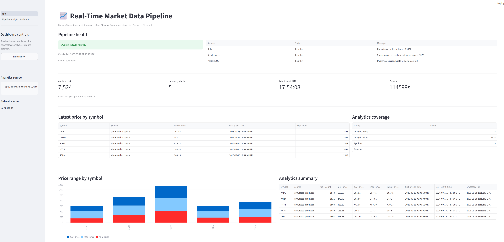

The primary cloud analytics layer uses dbt on Amazon Athena: three SQL models and 14 automated data-quality tests produce a latest-available stock metrics mart. Airflow orchestrates the dbt build, and a dedicated Streamlit page queries the mart. The original dashboard and guarded LLM assistant continue to read local Analytics Parquet.

Warehouse-portability validation extends the shared dbt transformation chain to Snowflake and Databricks using equivalent synthetic fixtures. A subsequent Databricks replay reads a published Clean v2 Parquet snapshot directly from Amazon S3 through Unity Catalog, builds three candidate views, and passes 18 data tests.

## Key Features

- Real-time streaming: Kafka ingests simulated stock-price ticks, and Spark Structured Streaming processes micro-batches every 10 seconds.
- Data-quality controls: Required-field validation, Kafka-offset deduplication, and a quarantine layer retain invalid events with explicit rejection reasons.
- Cloud analytics: Amazon Athena queries S3-backed Parquet data; dbt transforms validated stock events into staging, daily metrics, and a latest-available mart.
- Operational workflows: Airflow schedules data-quality and service-health checks, creates Athena snapshots, and executes dbt models and tests.
- Analytics experience: A Streamlit dashboard exposes current pipeline health, latest prices, summary metrics, and visual analytics.
- Natural-language analytics: An LLM-powered assistant translates supported business questions into safe, read-only analytics lookups over curated pipeline output.
- Warehouse portability: The shared Clean v2 dbt model chain has been validated on Snowflake and Databricks using equivalent synthetic fixtures.
- Direct S3 replay: Databricks Unity Catalog registers a published Clean v2 Parquet snapshot as an external table for a three-view dbt replay with 18 passing data tests.

## Demo

### Ask a natural-language question

> User: Show latest prices for AAPL, MSFT, and NVDA.
>
> Assistant: Returns the latest available prices, event timestamps, and processed tick counts from the curated Analytics Parquet output.

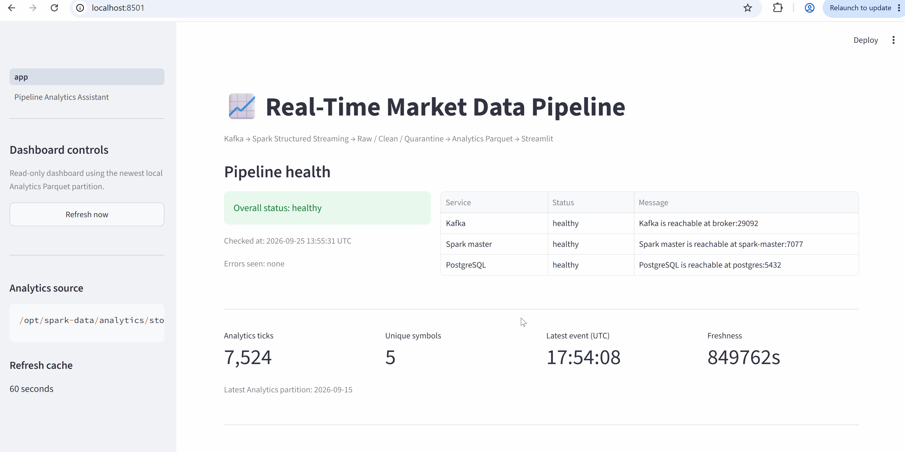

### Explore pipeline health and analytics

The dashboard presents service-health status, analytics freshness, symbol-level latest prices, price-range summaries, and processed-tick coverage.

Business value: The platform reduces time-to-insight by giving analysts a controlled way to inspect market-data summaries through a dashboard or natural-language questions, without manually querying raw streaming data or writing SQL.

The producer generates simulated events. Screenshots and validation counts demonstrate project behavior, not a live exchange feed, investment signal, or production performance guarantee.

For the full system design, see [ARCHITECTURE.md](ARCHITECTURE.md).

## Architecture

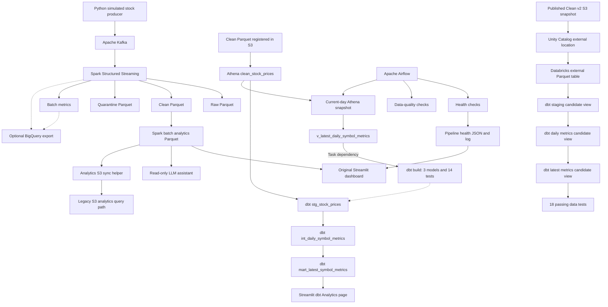

The Databricks branch is a manually executed snapshot-replay validation. It is separate from the scheduled Athena workflow and does not replace the streaming job, original dashboard, or assistant.

## Pipeline Flow

1. A Python producer publishes JSON stock-price events to the Kafka topic `pipeline-events`.
2. Spark Structured Streaming consumes Kafka micro-batches every 10 seconds.
3. Each batch is retained in the raw Parquet layer for traceability.
4. Spark validates required fields: a non-empty `symbol`, a positive numeric `price`, and `event_time`.
5. Valid events are deduplicated using Kafka topic, partition, and offset, then written to partitioned clean Parquet data.
6. Invalid events are retained in the quarantine layer with a validation-error reason.
7. Spark writes batch-level raw, clean, and quarantine counts to the metrics layer.
8. A Spark analytics job creates daily stock-price summaries by event date, symbol, and source.
9. Analytics Parquet is synchronized to Amazon S3 and queried through Athena.
10. Airflow schedules data-quality checks, health checks, and Athena-refresh work.
11. The Streamlit dashboard reads the latest analytics partition and pipeline-health status.
12. The Pipeline Analytics Assistant answers allowlisted natural-language questions about pipeline output and stock-price summaries.

The dbt cloud workflow additionally transforms S3-backed Clean events through Athena into staging, daily metrics, and latest-available mart views.

For the Databricks replay, a separately published Clean v2 S3 snapshot is registered through Unity Catalog and processed by the shared dbt candidate model chain.

## Tech Stack

| Layer | Technology | Purpose |
|---|---|---|
| Event producer | Python | Publishes simulated stock-price tick events |
| Event transport | Apache Kafka | Durable streaming through `pipeline-events` |
| Stream processing | Apache Spark 3.5 | Validation, deduplication, Parquet persistence, and batch metrics |
| Storage format | Apache Parquet | Raw, clean, quarantine, metrics, and analytics data layers |
| Orchestration | Apache Airflow 2.7 | Data-quality, health-check, and Athena-refresh workflows |
| Metadata database | PostgreSQL 14 | Airflow metadata storage |
| Cloud storage | Amazon S3 | Stores synchronized analytics data and published replay snapshots |
| Primary cloud query engine | Amazon Athena | Queries S3-backed stock-price data |
| Transformations and tests | dbt | Staging, daily metrics, latest-available marts, and data tests |
| Portability validation | Snowflake | Synthetic-fixture validation of the shared Clean v2 model chain |
| S3 replay validation | Databricks SQL and Unity Catalog | External Parquet registration and dbt replay from S3 |
| Cloud access control | AWS IAM | Role-based access to the replay snapshot |
| Dashboard | Streamlit | Displays pipeline health and market-data analytics |
| AI assistant | OpenAI API | Routes allowlisted natural-language analytics questions |
| Containerization | Docker Compose | Reproducible multi-service local environment |
| Optional warehouse export | Google BigQuery | Secondary export path for events and metrics |

## Data Layers

| Layer | Location | Purpose |
|---|---|---|
| Raw | `data/raw/stock_prices` | Immutable record of ingested Kafka payloads and ingestion metadata |
| Clean | `data/clean/stock_prices` | Validated and deduplicated stock-price events, partitioned by `event_date` |
| Quarantine | `data/quarantine/stock_prices` | Rejected events with validation-error context |
| Metrics | `data/metrics/stream_batches` | Per-micro-batch raw, clean, and quarantine counts |
| Analytics | `data/analytics/stock_price_summary` | Daily stock-price summary by date, symbol, and source |
| Monitoring | `data/monitoring` | Current pipeline-health JSON and append-only health history |
| S3 replay snapshot | S3 prefix ending in `replay/snowflake-clean-v2-20261015/` | Published Clean v2 Parquet snapshot used for the Databricks replay |
| Databricks replay | `workspace.clean_live_s3_replay_20261015` | External source table and three candidate analytics views |

The S3 prefix retains its original publication name. The `snowflake` segment in that name does not mean the snapshot is restricted to Snowflake; Databricks reads the Parquet objects directly.

## Analytics Model

The Spark analytics job produces daily stock-price summaries grouped by:

```text
event_date, symbol, source
```

Each summary contains:

```text
tick_count
min_price
max_price
avg_price
latest_price
first_event_time
last_event_time
processed_at
```

The analytics dataset is partitioned by `event_date`, supporting incremental and partition-aware cloud queries.

The dbt mart is a separate analytics interface. It exposes event counts, average/minimum/maximum prices, event dates, and the latest event timestamp. It does not expose a latest observed price or claim complete market-session OHLC coverage.

## Run Locally

### Prerequisites

- Docker Desktop with Docker Compose
- Python, if running local helper scripts
- AWS credentials configured only when using S3/Athena features
- An OpenAI API key in `.env` for the Pipeline Analytics Assistant
- A local `.env` file containing your configuration; do not commit this file

Databricks replay additionally requires access to a Databricks SQL warehouse, a configured Unity Catalog external location, and the `dbt-databricks` adapter.

### 1. Start the stack

From the repository root:

```powershell
docker compose up -d
```

Check service status:

```powershell
docker compose ps
```

Expected core services include:

```text
airflow
airflow-scheduler
broker
postgres
spark-master
spark-worker
stock-producer
pipeline-dashboard
```

### 2. Start the streaming job

Use the project helper script:

```powershell
.\start_stream.ps1
```

The streaming job reads Kafka events and writes raw, clean, quarantine, metrics, and checkpoint data under `data/`.

### 3. Build the analytics layer

After clean events exist, submit the analytics job:

```powershell
docker exec -it spark-master /opt/spark/bin/spark-submit `
  --master spark://spark-master:7077 `
  /opt/spark-apps/build_analytics_layer.py
```

### 4. Open local interfaces

| Service | Local URL |
|---|---|
| Airflow | `http://localhost:8080` |
| Spark Master UI | `http://localhost:8081` |
| Streamlit dashboard | `http://localhost:8501` |

### 5. Verify monitoring

Trigger `pipeline_health_check` in Airflow, or wait for its five-minute schedule. Then inspect:

```powershell
Get-Content .\data\monitoring\pipeline_status.json
Get-Content .\data\monitoring\pipeline_health.log -Tail 5
```

A healthy result includes:

```json
{
  "status": "healthy",
  "errors_seen": []
}
```

## Pipeline Evidence

### Active Spark Structured Streaming Job

The Spark Master UI shows the active `kafka-to-parquet-stream` application consuming events from Kafka with a live worker and allocated executor resources.

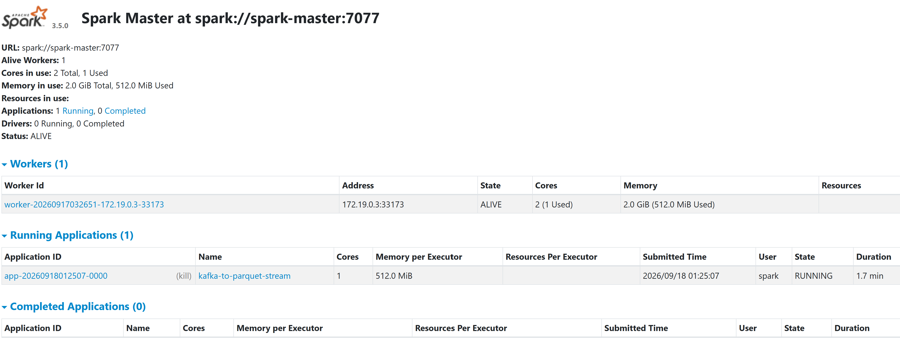

### Data-Quality Quarantine Handling

Spark validates every incoming stock-price event before it reaches the clean layer. Records that fail validation are retained in the quarantine Parquet layer with their validation reason and quarantine timestamp instead of being silently dropped.

The example below shows an intentionally invalid `AAPL` event with `price = -25.5` routed to quarantine with `validation_error = non_positive_price`.

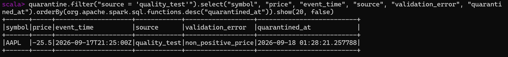

### Airflow Orchestration

Airflow schedules data-quality and pipeline-health checks every five minutes and refreshes Athena analytics every 30 minutes.

| DAG | Schedule | Responsibility |
|---|---|---|
| `pipeline_data_quality_check` | Every 5 minutes | Validates pipeline data-quality expectations |
| `pipeline_health_check` | Every 5 minutes | Verifies Kafka, Spark Master, and PostgreSQL connectivity |
| `refresh_athena_analytics` | Every 30 minutes | Creates a current-day snapshot, updates `v_latest_daily_symbol_metrics`, then builds and tests dbt views |

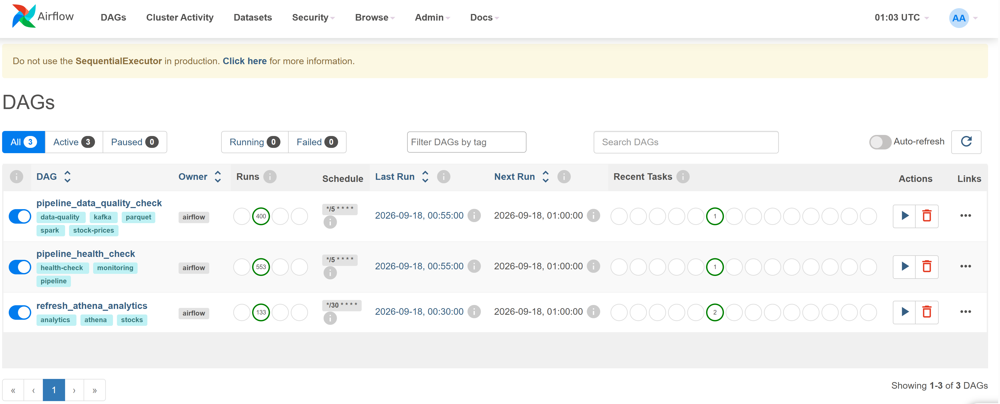

The Athena/dbt DAG permits two retries with a one-minute delay. Other DAGs use their own configured retry settings. The health-check DAG writes operational artifacts to:

```text
data/monitoring/
├── pipeline_status.json
└── pipeline_health.log
```

`pipeline_status.json` contains the latest machine-readable health snapshot, while `pipeline_health.log` maintains append-only execution history.

For operational details, see [MONITORING.md](MONITORING.md) and [RUNBOOK.md](RUNBOOK.md).

### Amazon Athena Analytics

Analytics Parquet data is synchronized to Amazon S3 and queried through the `v_latest_stock_price_summary` Athena view.

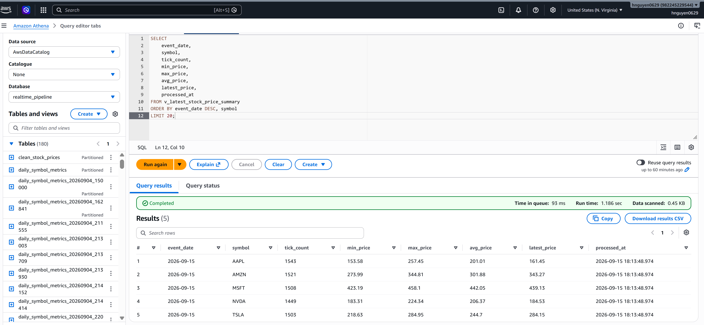

The original analytics publication workflow is:

```text
Clean Parquet → Analytics Parquet → Amazon S3 → Amazon Athena
```

Use the included helper to synchronize local analytics data:

```powershell
.\sync_to_s3.ps1
```

AWS credentials and bucket details remain in local configuration and are never committed.

The dbt Athena workflow reads the registered Clean source directly; it is distinct from the Analytics Parquet synchronization path.

## Pipeline Analytics Assistant

The dashboard includes a guarded natural-language assistant for pipeline health and stock-price analytics. It reads the same Analytics Parquet output used by the original dashboard.

The assistant uses allowlisted query patterns. It is intentionally read-only: it cannot modify data, control services, run arbitrary SQL, or provide financial advice.

Supported questions include:

```text
Summarize the latest pipeline output
What is the latest price for AAPL?
Show latest prices for AAPL, MSFT, and NVDA
Give me AAPL summary for 2026-09-15
```

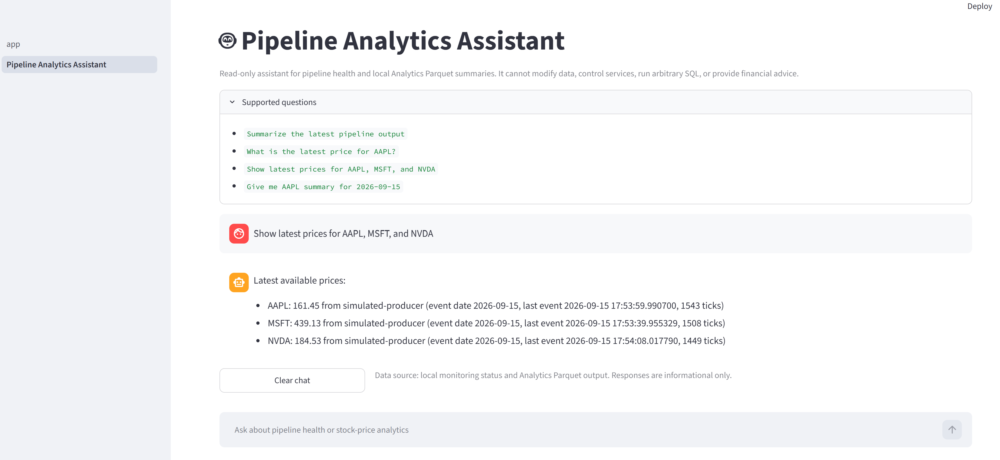

## Validation and Testing

Run Python tests from the repository root:

```powershell
python -m pytest tests -v
```

Run the Spark smoke test:

```powershell
docker exec -it spark-master /opt/spark/bin/spark-submit `
  --master spark://spark-master:7077 `
  /opt/spark-apps/smoke_test.py
```

Operational validation checklist:

- Docker services are running: `docker compose ps`
- Spark Structured Streaming is active and writing data
- Raw, clean, quarantine, metrics, and analytics layers exist under `data/`
- Invalid records include an explicit rejection reason in quarantine Parquet
- Airflow health-check and data-quality DAGs complete successfully
- `data/monitoring/pipeline_status.json` reports `healthy`
- Athena queries the S3-backed analytics table or view
- The Streamlit dashboard renders the latest analytics output
- The Pipeline Analytics Assistant answers allowlisted questions only

### dbt validation counts

| Validation scope | Models | Data tests | Interpretation |
|---|---:|---:|---|
| Original Athena analytics | 3 | 14 | A successful combined build has 17 successful resources |
| Clean v2 synthetic-fixture portability | 3 | 18 | A successful combined build has 21 successful resources |
| Databricks direct S3 snapshot replay | 3 | 18 | Separate runs reported `PASS=3` for models and `PASS=18` for tests |

Model counts and test counts are separate. A combined `PASS=21` result means three models plus 18 tests, not 21 tests.

## Optional Google BigQuery Export

BigQuery export and Looker Studio demonstrate a secondary warehouse/reporting path.

The primary scheduled dbt cloud workflow is:

```text
S3-backed Clean events
→ Athena
→ dbt views
→ dedicated Streamlit dbt Analytics page
```

The original dashboard and assistant read local Analytics Parquet. The Databricks integration is a separate snapshot-replay validation.

The `gcp/` directory contains optional utilities that export pipeline events and streaming metrics to a Google BigQuery dataset named `realtime_pipeline`.

| Script | Source | BigQuery table |
|---|---|---|
| `gcp/export_events_to_bigquery.py` | Pipeline events | `realtime_pipeline.events` |
| `gcp/export_metrics_to_bigquery.py` | Streaming metrics | `realtime_pipeline.metrics` |

### BigQuery Event Export

The optional event export loads pipeline event records into `realtime_pipeline.events` for cloud-warehouse analysis.

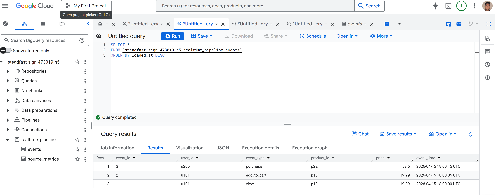

### BigQuery Metrics Export

The optional metrics evidence also includes source-level event counts and revenue metrics queried from `realtime_pipeline.source_metrics`.

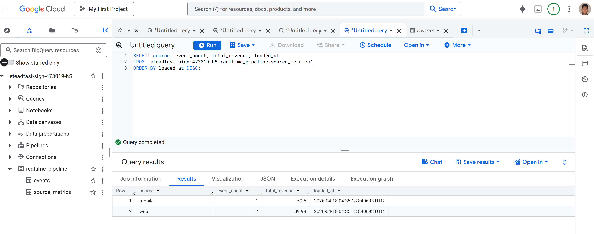

### Optional Looker Studio Exploration

A Looker Studio dashboard can visualize the optional BigQuery export path.

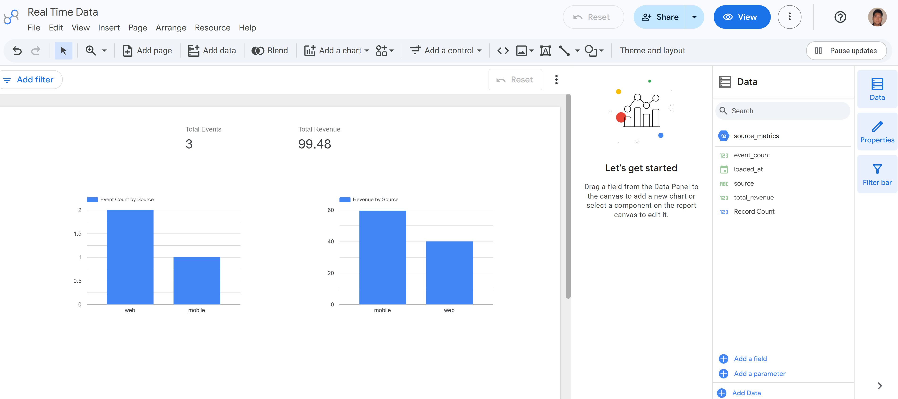

See [gcp/README.md](gcp/README.md) for requirements and usage.

## Engineering Decisions

- Layered Parquet storage: Raw, clean, quarantine, metrics, and analytics layers preserve traceability while separating valid events from rejected data.
- Kafka-offset deduplication: Kafka topic, partition, and offset provide a stable event identity within the stream.
- Partitioned analytics: Clean and analytics data are partitioned by event date for partition-aware processing and queries.
- Quarantine instead of silent drops: Invalid events are preserved with explicit error reasons.
- Independent orchestration: Airflow manages data quality, infrastructure health, and Athena refresh as separate workflows.
- Retry logic: The Athena/dbt DAG permits two retries with a one-minute delay; the dbt task has a ten-minute execution timeout.
- Machine-readable monitoring: The health DAG produces a current JSON status file and append-only health log.
- Guarded AI assistant: The assistant uses allowlisted queries and cannot modify data, execute arbitrary SQL, or operate infrastructure.
- Local-first reproducibility: Docker Compose runs the local stack, while S3/Athena provides the primary cloud analytics path.
- Shared dbt transformations: Platform-aware source mappings and adapter-dispatched timestamp parsing support warehouse portability without separate copies of the three transformation models.
- Explicit Clean v2 opt-in: `use_clean_stock_prices_v2: true` selects the Clean v2 source and candidate view aliases; the legacy branch remains the default.
- Isolated replay namespace: The Databricks S3 replay uses `workspace.clean_live_s3_replay_20261015` to separate replay outputs from earlier validation schemas.
- Role-based S3 access: The Databricks external location uses a Unity Catalog storage credential backed by an AWS IAM role.
- Optional BigQuery support: Export utilities remain a secondary integration rather than a required part of the primary architecture.

## Project Structure

```text
Real-Time-Data-Engineering-Pipeline/
├── airflow/
│   ├── Dockerfile.dbt
│   └── dags/
│       ├── pipeline_data_quality_check.py
│       ├── pipeline_health_check.py
│       └── refresh_athena_analytics.py
├── dashboard/
│   ├── app.py
│   └── pages/
│       ├── 1_Pipeline_Analytics_Assistant.py
│       └── 1_dbt_Analytics.py
├── data/
│   └── monitoring/
│       └── .gitkeep
├── dbt/
│   ├── dbt_project.yml
│   ├── fixtures/
│   │   ├── snowflake-clean-v2.sql
│   │   ├── databricks-clean-v2.sql
│   │   ├── snowflake-clean-v2-replay-20261014.sql
│   │   └── databricks-clean-v2-replay-20261014.sql
│   ├── macros/
│   ├── models/
│   ├── profile_examples/
│   │   ├── snowflake/
│   │   └── databricks/
│   ├── requirements/
│   └── tests/
├── docs/
│   ├── warehouse-portability-validation.md
│   ├── warehouse-portability-replay-20261014.md
│   └── screenshots/
│       └── 20261015_databricks_s3_replay/
├── gcp/
│   ├── README.md
│   ├── export_events_to_bigquery.py
│   └── export_metrics_to_bigquery.py
├── images/
├── llm/
│   ├── __init__.py
│   ├── analytics_backend.py
│   ├── assistant.py
│   └── demo.py
├── producer/
│   ├── requirements.txt
│   └── stock_producer.py
├── spark/
│   └── jobs/
│       ├── build_analytics_layer.py
│       ├── kafka_stream.py
│       └── smoke_test.py
├── tests/
├── utils/
├── ARCHITECTURE.md
├── docker-compose.yml
├── MONITORING.md
├── README.md
├── RUNBOOK.md
├── run_health_check.ps1
├── start_stream.ps1
└── sync_to_s3.ps1
```

Local virtual environments, active credential profiles, generated dbt artifacts, and logs are excluded from Git. The local replay profile directory used in the commands below is intentionally omitted from the tracked project structure.

## dbt Analytics Layer

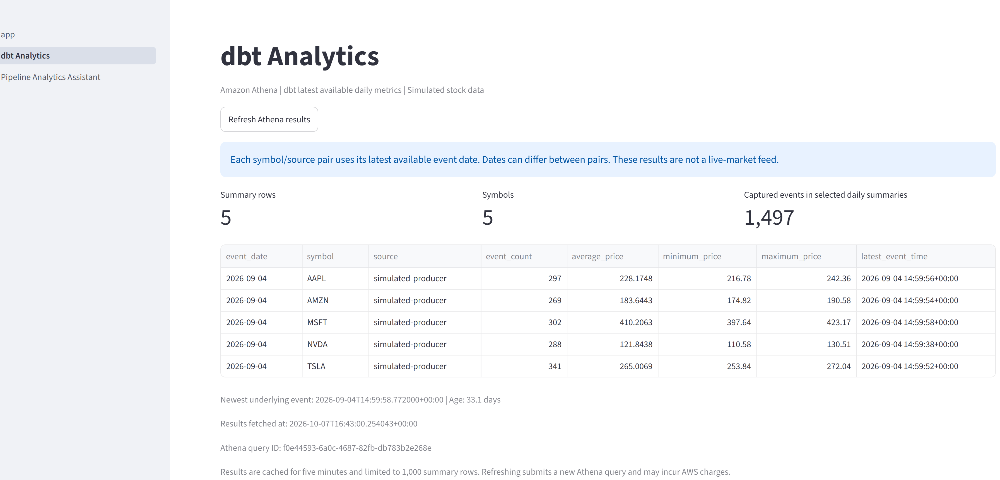

The primary dbt project queries the existing S3-backed Athena table `realtime_pipeline.clean_stock_prices`. It does not ingest Kafka events, upload local Clean files, or replace the Spark streaming job.

### Models

| Model | Materialization | Grain and purpose |
|---|---|---|
| `stg_stock_prices` | View | Event-level data with normalized symbols and retained Kafka metadata |
| `int_daily_symbol_metrics` | View | Daily captured-event metrics by event date, symbol, and source |
| `mart_latest_symbol_metrics` | View | Latest available daily metrics for each symbol/source pair |

The mart exposes event counts, average/minimum/maximum prices, event dates, and the latest event timestamp. It does not expose a latest observed price or claim complete market-session OHLC coverage.

Each symbol/source pair can have a different latest available date. Historical sample data is explicitly labeled; query time is not event time.

### Automated tests

The original Athena validation project contains 14 data tests:

- Staging: four required-field tests and one positive-price/nonblank-symbol test.
- Intermediate: three required-field tests.
- Mart: five required-field tests and one symbol/source uniqueness test.

A successful `dbt build` reports 17 successful resources: three models plus 14 tests. This does not represent 17 tests or an uptime SLA.

The Clean v2 warehouse-portability replay chain contains 18 data tests. A successful combined replay build reports 21 successful resources: three candidate views plus 18 tests.

### Airflow execution

The `refresh_athena_analytics` DAG runs every 30 minutes:

```text
refresh_daily_symbol_metrics
    → update_latest_metrics_view
    → dbt_build_analytics
```

The first task creates a current-day Parquet snapshot from `clean_stock_prices`. The second updates `v_latest_daily_symbol_metrics`. The final task builds and tests the dbt models.

The dbt source is `clean_stock_prices`, not the snapshot view. The dependency controls execution order; it does not make the dbt models read the snapshot or perform an upstream S3 sync.

### Dashboard and assistant boundaries

- Original Streamlit dashboard: local Analytics Parquet and pipeline-health artifacts.
- dbt Analytics page: fixed read-only Athena query against `mart_latest_symbol_metrics`.
- LLM assistant: existing allowlisted lookups against local Analytics Parquet.
- Databricks replay: SQL and dbt validation; no Databricks-backed dashboard or assistant integration is claimed.

The dbt page caches results for five minutes and displays event timestamps, result-fetch time, and an Athena query ID.

### Running dbt in Docker

The custom Airflow image uses Python 3.11 and installs dbt in `/opt/dbt-venv`, separate from Airflow packages.

Build the image before starting the stack:

```powershell
docker compose build airflow-scheduler
docker compose up -d
```

Create the Git-ignored `dbt/profiles/profiles.yml` locally:

```yaml
stock_analytics:
  target: dev
  outputs:
    dev:
      type: athena
      database: awsdatacatalog
      schema: "{{ env_var('ATHENA_DATABASE') }}"
      region_name: "{{ env_var('AWS_REGION') }}"
      s3_staging_dir: "{{ env_var('ATHENA_OUTPUT') }}"
      threads: 2
```

Supply AWS credentials through local configuration, never committed files. The AWS identity needs appropriate Athena, S3, and Glue permissions.

Run the models and tests:

```powershell
docker compose exec -e DBT_LOG_PATH=/tmp/dbt-logs -e DBT_TARGET_PATH=/tmp/dbt-target airflow-scheduler /opt/dbt-venv/bin/dbt build --project-dir /opt/airflow/dbt --profiles-dir /opt/airflow/dbt/profiles
```

Generate documentation:

```powershell
docker compose exec -e DBT_LOG_PATH=/tmp/dbt-docs-logs -e DBT_TARGET_PATH=/tmp/dbt-docs airflow-scheduler /opt/dbt-venv/bin/dbt docs generate --project-dir /opt/airflow/dbt --profiles-dir /opt/airflow/dbt/profiles
```

Documentation generation was validated on October 7, 2026 and produced `index.html`, `manifest.json`, and `catalog.json`.

These files are generated under `/tmp/dbt-docs` inside the scheduler container and are temporary; regenerate them after container replacement. Generated metadata may contain infrastructure identifiers and should be reviewed before publication.

### Validated sample

The October 7, 2026 validation displayed 1,497 simulated events summarized across five symbols: AAPL, AMZN, MSFT, NVDA, and TSLA. The displayed event date was September 4, 2026.

These are sample-validation counts, not daily throughput, live-data freshness, or production-scale performance claims.

### Relevant source files

```text
airflow/Dockerfile.dbt
dashboard/pages/1_dbt_Analytics.py
dbt/dbt_project.yml
dbt/models/sources.yml
dbt/models/staging/stg_stock_prices.sql
dbt/models/staging/staging.yml
dbt/models/intermediate/int_daily_symbol_metrics.sql
dbt/models/intermediate/intermediate.yml
dbt/models/marts/mart_latest_symbol_metrics.sql
dbt/models/marts/marts.yml
dbt/tests/assert_stock_price_values_valid.sql
dbt/tests/assert_latest_symbol_metrics_unique.sql
```

## dbt Warehouse Portability

The original Athena validation remains the primary scheduled cloud-analytics workflow.

Warehouse portability was validated in two distinct stages:

1. Synthetic-fixture validation on Snowflake and Databricks.
2. Direct S3 snapshot replay on Databricks through Unity Catalog.

The second stage adds real cloud-storage integration to the Databricks validation; it does not change the scope of the earlier synthetic-fixture results.

### Synthetic-fixture validation

The shared dbt model chain was executed on Snowflake and Databricks using equivalent six-row synthetic fixtures:

```text
Clean v2 source
    → staging
    → daily symbol metrics
    → latest-available symbol metrics
```

Adapter-dispatched timestamp parsing and platform-aware source mappings allow the same model chain to run without separate copies of the three transformation models.

| Original fixture validation | Snowflake | Databricks |
|---|---|---|
| dbt Core | 1.12.5 | 1.12.0 |
| Adapter | dbt-snowflake 1.12.1 | dbt-databricks 1.12.4 |
| Candidate views built | 3 | 3 |
| Data tests passed | 18 | 18 |
| Combined build result | PASS=21, ERROR=0, SKIP=0 | PASS=21, ERROR=0, SKIP=0 |

Runs explicitly enable `use_clean_stock_prices_v2: true` and build `*_v2_candidate` views. The legacy source branch remains the default.

These original results demonstrate synthetic-fixture transformation portability, not live S3 integration or scheduled execution on the additional platforms.

### Independent fixture replay

The saved fixture scripts were independently replay-tested on October 14, 2026 in isolated Snowflake and Databricks schemas.

Both replays rebuilt the three Clean v2 candidate views and passed all 18 data tests. Detailed replay commands, fixture verification, version information, and execution screenshots are recorded in the replay document.

- [Original validation record and execution screenshots](docs/warehouse-portability-validation.md)
- [Independent replay record and execution screenshots](docs/warehouse-portability-replay-20261014.md)
- [Original Snowflake fixture SQL](dbt/fixtures/snowflake-clean-v2.sql)
- [Original Databricks fixture SQL](dbt/fixtures/databricks-clean-v2.sql)
- [Snowflake replay fixture SQL](dbt/fixtures/snowflake-clean-v2-replay-20261014.sql)
- [Databricks replay fixture SQL](dbt/fixtures/databricks-clean-v2-replay-20261014.sql)
- [Snowflake development profile example](dbt/profile_examples/snowflake/profiles.example.yml)
- [Databricks interactive OAuth profile example](dbt/profile_examples/databricks/profiles.example.yml)
- [Snowflake replay profile example](dbt/profile_examples/snowflake/profiles.replay-20261014.example.yml)

Separate Windows/Python 3.11 dependency snapshots are available under `dbt/requirements/`. Both Airflow v2 DAGs remained paused during the original validation and fixture-replay work.

## Databricks Direct S3 Snapshot Replay

On October 16, 2026, the Clean v2 candidate model chain was successfully executed against a published S3 Parquet snapshot through Databricks Unity Catalog.

Unlike the earlier six-row fixture validation, this replay reads the published Parquet objects through an external table rather than creating a synthetic source table inside the warehouse.

The `20261015` suffix identifies the replay snapshot and namespace. The execution and screenshot capture occurred on October 16, 2026.

### Validated replay path

```text
Published Clean v2 Parquet snapshot in S3
    → AWS IAM role
    → Unity Catalog storage credential
    → Unity Catalog external location
    → external Parquet table
    → stg_stock_prices_v2_candidate
    → int_daily_symbol_metrics_v2_candidate
    → mart_latest_symbol_metrics_v2_candidate
    → 18 passing dbt data tests
```

### Replay configuration

| Setting | Value |
|---|---|
| Catalog | `workspace` |
| Source schema | `clean_live_s3_replay_20261015` |
| dbt output schema | `clean_live_s3_replay_20261015` |
| External location | `s3-replay-20261015` |
| External source table | `clean_stock_prices_v2` |
| Source format | Parquet |
| Authentication | Interactive OAuth |
| dbt Core | 1.12.5 |
| Databricks adapter | 1.12.7 |
| Candidate views built | 3 |
| Data tests passed | 18 |

The external location uses a storage credential backed by an AWS IAM role. The credential name is environment-specific; use the credential linked to the external location rather than assuming a fixed name.

S3 read, list, write, delete, path-existence, role-assumption, self-assumption, and external-ID checks passed during setup.

Optional file-events permission validation did not pass. The external location was created without verified file-events provisioning; this milestone does not claim file-events-based ingestion.

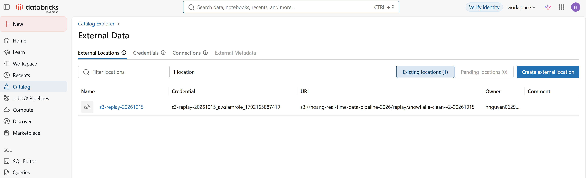

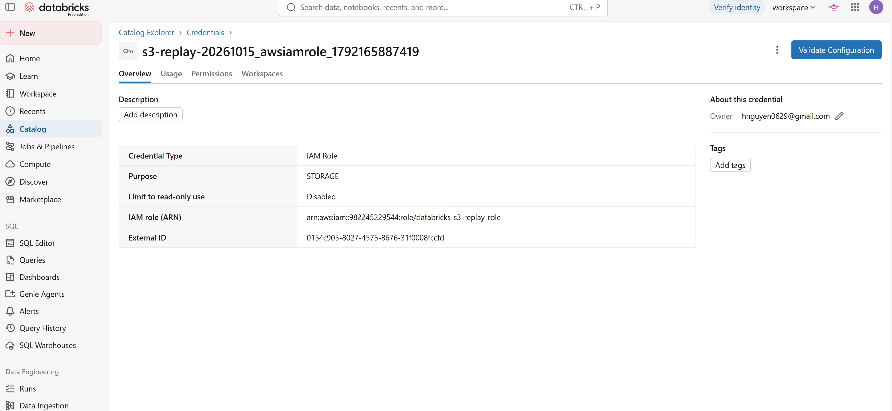

### External table

The existing source table can be inspected without recreating it:

```sql
DESCRIBE EXTENDED
workspace.clean_live_s3_replay_20261015.clean_stock_prices_v2;
```

The captured metadata documents the external table, Parquet provider, and S3 snapshot location.

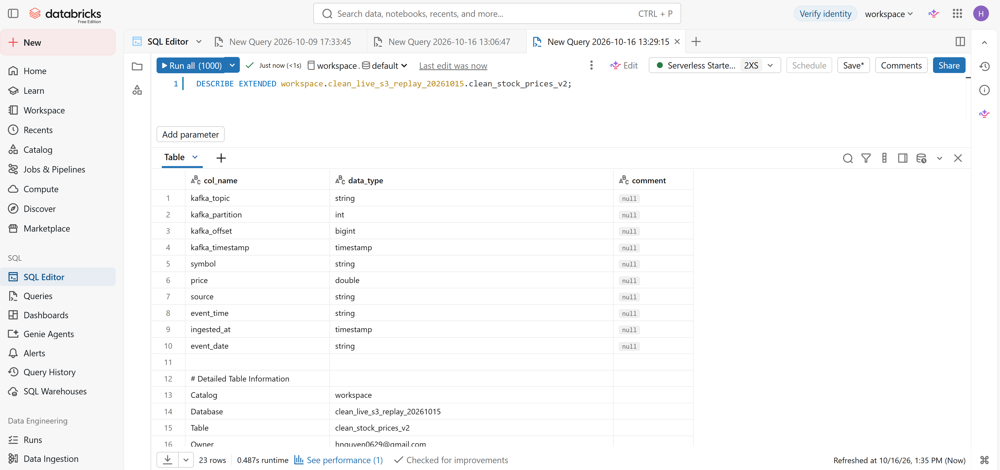

### Source verification

The source-verification query is:

```sql
SELECT
    COUNT(*) AS row_count,
    COUNT(DISTINCT kafka_offset) AS distinct_offsets
FROM workspace.clean_live_s3_replay_20261015.clean_stock_prices_v2;
```

The screenshot records the observed values for the published snapshot.

Distinct offsets are a snapshot diagnostic, not a complete Kafka identity uniqueness check. The pipeline event identity uses topic, partition, and offset together.

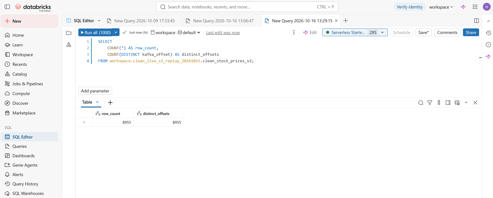

### Local profile configuration

The local replay profile uses the following structure:

```yaml
stock_analytics:
  target: databricks_replay
  outputs:
    databricks_replay:
      type: databricks
      catalog: workspace
      schema: CLEAN_LIVE_S3_REPLAY_20261015
      host: "<your-databricks-workspace-host>"
      http_path: "<your-sql-warehouse-http-path>"
      auth_type: oauth
      threads: 1
```

The active profile is local and Git-ignored.

The profile schema controls where dbt writes its models. Source environment variables independently control where dbt reads its source table.

During setup, the profile initially targeted `DBT_REPLAY_20261014`, so successful model executions wrote views to that earlier schema. Updating the active profile to `CLEAN_LIVE_S3_REPLAY_20261015` placed the candidate views in the intended replay namespace.

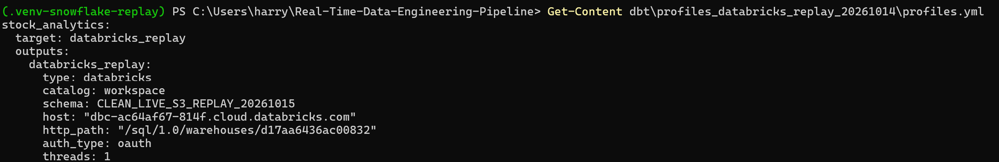

### Replay commands

Run from the repository root in an environment with the Databricks adapter installed.

The following commands use the local profile directory from this validation:

```powershell
$env:DBT_SOURCE_DATABASE = "workspace"
$env:DBT_SOURCE_SCHEMA = "clean_live_s3_replay_20261015"

dbt debug `
  --project-dir dbt `
  --profiles-dir dbt\profiles_databricks_replay_20261014
```

Build the candidate views:

```powershell
dbt run `
  --project-dir dbt `
  --profiles-dir dbt\profiles_databricks_replay_20261014 `
  --vars '{"use_clean_stock_prices_v2": true}'
```

Run the data tests:

```powershell
dbt test `
  --project-dir dbt `
  --profiles-dir dbt\profiles_databricks_replay_20261014 `
  --vars '{"use_clean_stock_prices_v2": true}'
```

The profile directory retains its earlier `20261014` name. Its configured target schema—not the directory name—determines the destination for the models.

The project file is `dbt/dbt_project.yml`, so commands run from the repository root include `--project-dir dbt`.

No `clean_v2` tag is required for these commands. The Clean v2 branch is enabled through the dbt variable.

### Execution results

The successful model execution reported:

```text
PASS=3 WARN=0 ERROR=0 SKIP=0
```

The successful data-test execution reported:

```text
PASS=18 WARN=0 ERROR=0 SKIP=0
```

These are separate command summaries: three successful model builds and 18 passing tests.

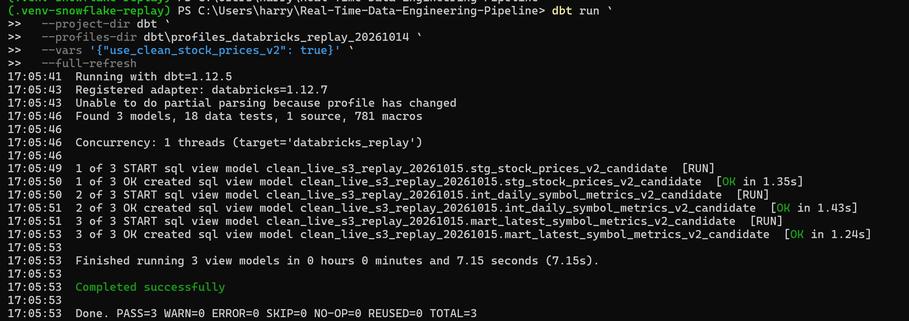

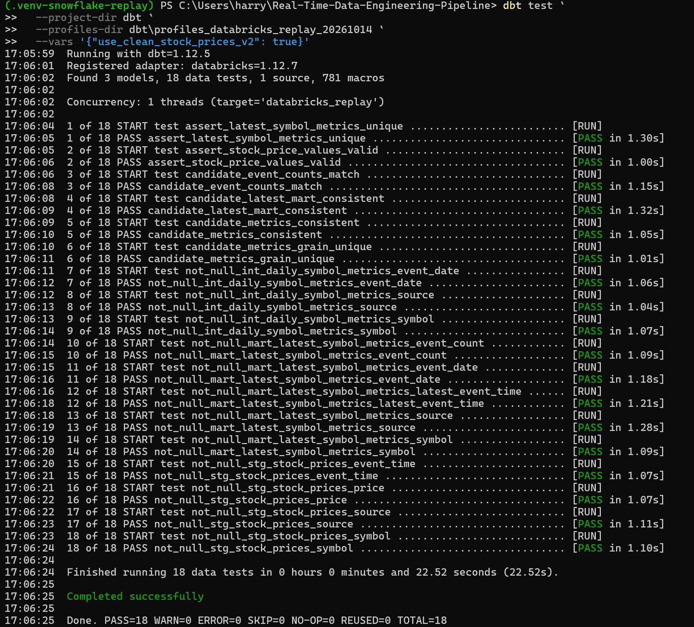

### Candidate views

The replay creates:

```text
workspace.clean_live_s3_replay_20261015.stg_stock_prices_v2_candidate
workspace.clean_live_s3_replay_20261015.int_daily_symbol_metrics_v2_candidate
workspace.clean_live_s3_replay_20261015.mart_latest_symbol_metrics_v2_candidate
```

Inspect them in Databricks SQL:

```sql
USE CATALOG workspace;
USE SCHEMA clean_live_s3_replay_20261015;
SHOW VIEWS;
```

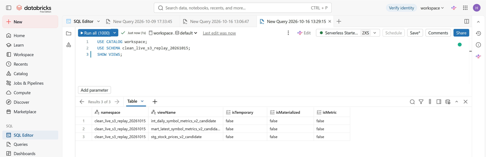

Preview the mart:

```sql
SELECT *
FROM workspace.clean_live_s3_replay_20261015.mart_latest_symbol_metrics_v2_candidate
LIMIT 10;
```

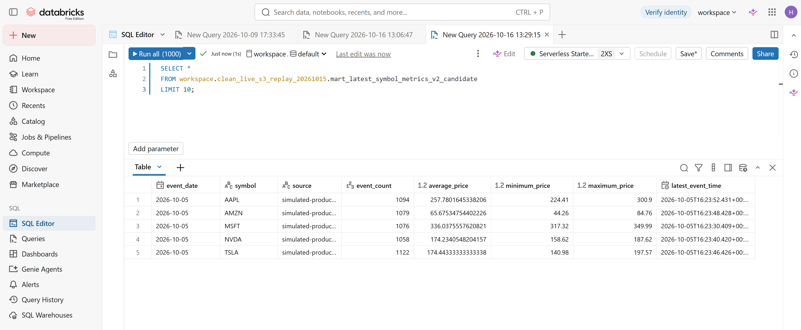

### Scope and limitations

This milestone validates:

- Direct access to a published Clean v2 S3 Parquet snapshot through Unity Catalog.
- Successful creation of three dbt candidate views in the intended replay schema.
- Execution of 18 passing data tests.
- Reuse of the shared dbt transformation chain with a platform-specific source mapping.

It does not establish:

- Continuous Kafka-to-Databricks streaming ingestion.
- Scheduled Databricks execution through Airflow.
- File-events-based ingestion.
- Automated Snowflake-versus-Databricks row-level or aggregate parity.
- Databricks integration with the Streamlit dashboard or LLM assistant.
- Production-scale throughput, latency, cost, or availability guarantees.

The replay is a point-in-time validation of the published snapshot and dbt model chain.

## Screenshots and Documentation

Existing dashboard, streaming, orchestration, Athena, and optional BigQuery screenshots remain under [`images/`](images/).

Databricks S3 replay evidence is stored separately under:

```text
docs/screenshots/20261015_databricks_s3_replay/
├── 01_external_location.png
├── 02_storage_credential_details.png
├── 03_external_table_creation.png
├── 04_s3_source_row_count.png
├── 05_dbt_profile_live_s3_schema.png
├── 06_dbt_run_success.png
├── 07_dbt_test_pass_18.png
├── 08_databricks_model_views.png
└── 09_mart_preview.png
```

The replay evidence covers external access configuration, source metadata and counts, dbt configuration, successful model and test execution, and the resulting analytics views.

Public-facing screenshots should be reviewed for secrets, personal information, external IDs, and infrastructure identifiers before publication. Optional validation warnings should remain accurately represented.

The `images/` directory also retains implementation and validation artifacts from supporting or exploratory work, including Airflow cluster activity and Cassandra validation.

## License

This project is licensed under the MIT License. See [LICENSE.txt](LICENSE.txt).