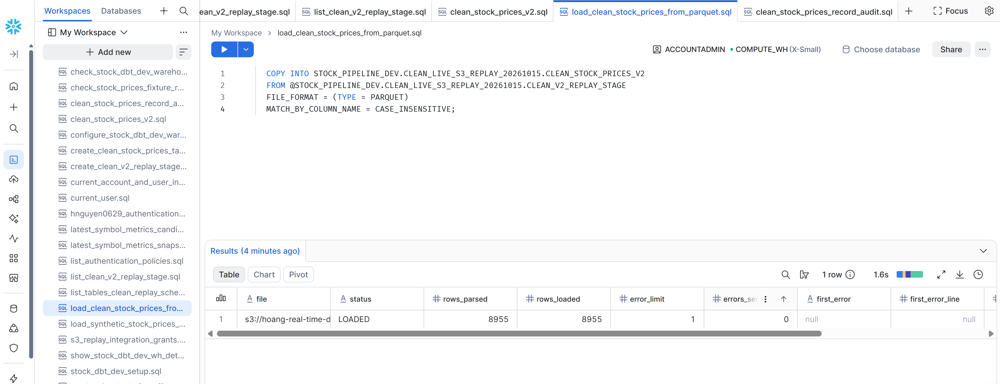
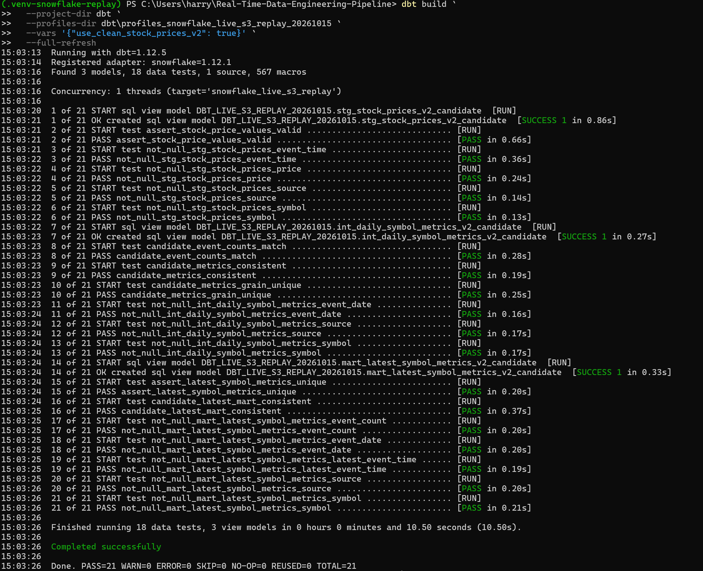

# Snowflake Clean v2 Live S3 Replay Validation

## Milestone

Validated the shared dbt Clean v2 transformation layer using a Snowflake table
loaded from an S3-backed replay snapshot.

- **Date:** 2026-10-15
- **Snowflake database:** `STOCK_PIPELINE_DEV`
- **Replay schema:** `CLEAN_LIVE_S3_REPLAY_20261015`
- **Replay table:** `CLEAN_STOCK_PRICES_V2`
- **S3 replay prefix:** `s3://hoang-real-time-data-pipeline-2026/replay/snowflake-clean-v2-20261015/`
- **dbt output schema:** `DBT_LIVE_S3_REPLAY_20261015`
- **Models built:** 3
- **Data tests executed:** 18
- **Final dbt result:** `PASS=21, WARN=0, ERROR=0, SKIP=0`

## S3-to-Snowflake path

```text
Athena Clean v2 source
  → S3 replay prefix
  → Snowflake external stage
  → COPY INTO Snowflake replay table
  → dbt Clean v2 candidate chain
  → PASS=21
```

## Source verification

The S3-loaded Snowflake replay table contained 8,955 events with 8,955
distinct Kafka offsets.

| Metric | Result |
|---|---:|
| Source rows | 8,955 |
| Distinct Kafka offsets | 8,955 |
| Duplicate Kafka offsets | 0 |

## dbt replay command

```powershell
dbt build `
  --project-dir dbt `
  --profiles-dir dbt\profiles_snowflake_live_s3_replay_20261015 `
  --vars '{"use_clean_stock_prices_v2": true}' `
  --full-refresh
```

## Evidence

### S3 load and source verification



### dbt build result



### Final mart result


## Warehouse replay status

| Warehouse | Clean v2 validation type | Result |
|---|---|---|
| Athena | Live S3-backed Parquet source | PASS=21 |
| Snowflake | S3-loaded replay table | PASS=21 |
| Databricks | Synthetic six-row fixture replay | PASS=21 |