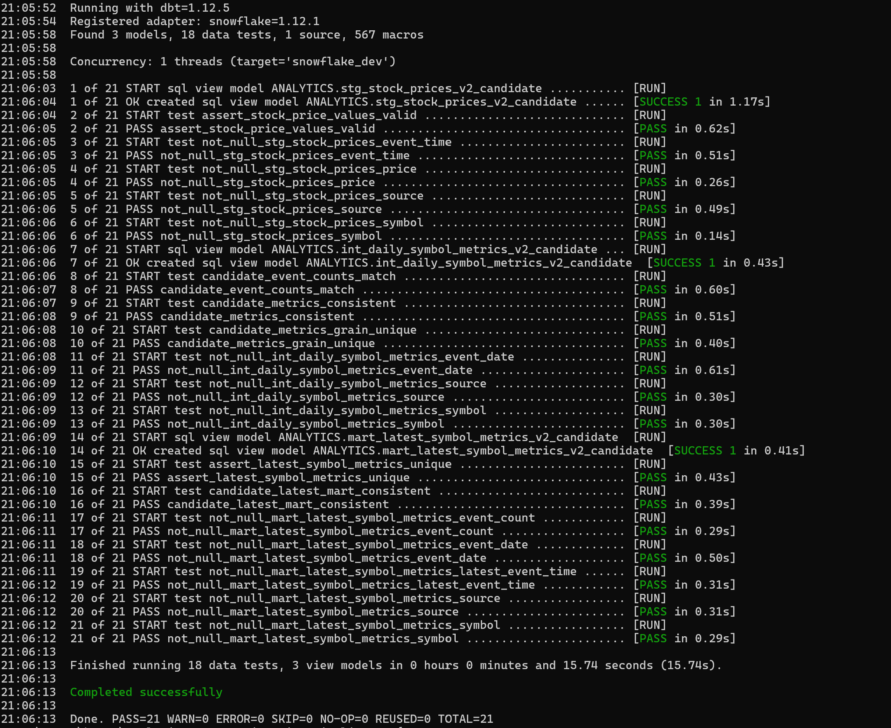
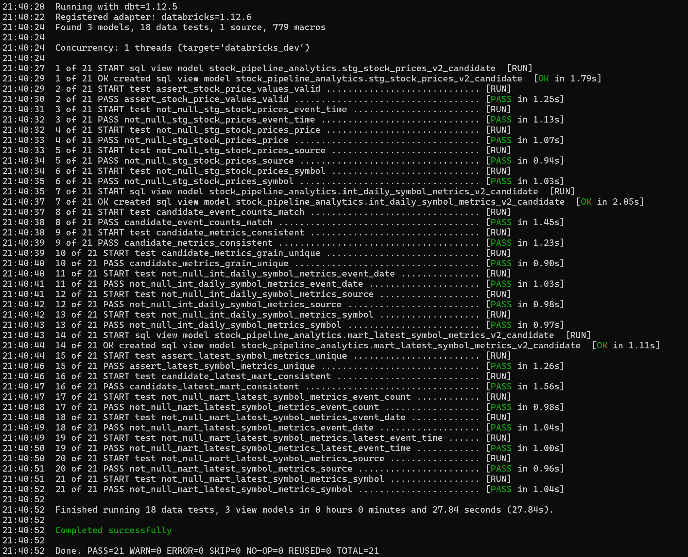
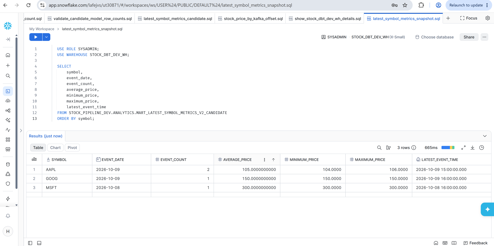
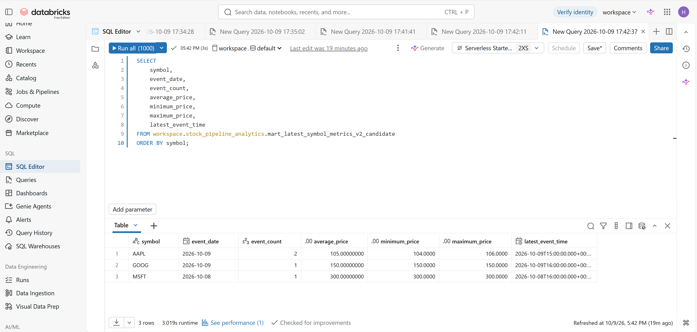

# Warehouse Portability Validation

## Scope

The shared dbt model chain was executed successfully on Snowflake and
Databricks using a six-row synthetic stock-price fixture.

This validates the candidate transformations and their existing data tests
for the tested fixture. It does not validate live ingestion, production
deployment, or scheduled execution.

Validation date: 2026-10-09
Implementation commit: 7575e2b

## Shared Model Chain

1. stg_stock_prices
2. int_daily_symbol_metrics
3. mart_latest_symbol_metrics

Runs explicitly enabled:

```yaml
use_clean_stock_prices_v2: true
```

The resulting view aliases are:

- stg_stock_prices_v2_candidate
- int_daily_symbol_metrics_v2_candidate
- mart_latest_symbol_metrics_v2_candidate

The legacy branch remains the default when the variable is not enabled.
Clean publish-validation models remain disabled by default.

## Tested Environments

| Component | Snowflake | Databricks |
|---|---|---|
| Python | 3.11.3 on Windows | 3.11.3 on Windows |
| dbt Core | 1.12.5 | 1.12.5 |
| Platform adapter | dbt-snowflake 1.12.1 | dbt-databricks 1.12.6 |
| Authentication | Username/password | Interactive OAuth |
| Models built | 3 views | 3 views |
| Data tests passed | 18 | 18 |
| Build summary | PASS=21 WARN=0 ERROR=0 SKIP=0 | PASS=21 WARN=0 ERROR=0 SKIP=0 |

Dependency snapshots:

- dbt/requirements/snowflake-windows-py311.txt
- dbt/requirements/databricks-windows-py311.txt

These snapshots record the tested Windows/Python environments. A fresh
installation from the snapshots has not yet been independently retested.

## Source Configuration

Both source YAML files use adapter-aware database and schema mappings:

| Adapter | Source database/catalog | Source schema |
|---|---|---|
| Athena | awsdatacatalog | ATHENA_DATABASE |
| Snowflake | DBT_SOURCE_DATABASE | DBT_SOURCE_SCHEMA |
| Databricks | DBT_SOURCE_DATABASE | DBT_SOURCE_SCHEMA |

Tested values:

| Platform | Database/catalog | Source schema | Output schema |
|---|---|---|---|
| Snowflake | STOCK_PIPELINE_DEV | CLEAN | ANALYTICS |
| Databricks | workspace | stock_pipeline_clean | stock_pipeline_analytics |

With the v2 variable enabled, the source table identifier is
clean_stock_prices_v2.

DBT_SOURCE_DATABASE and DBT_SOURCE_SCHEMA must be reset when switching
platforms in the same terminal session.

## Authentication and Local Profiles

Credential-free examples:

- dbt/profile_examples/snowflake/profiles.example.yml
- dbt/profile_examples/databricks/profiles.example.yml

Working platform profiles were stored outside the repository.

The Snowflake example uses a secret environment-variable reference rather
than a hardcoded password. Account policy may require MFA or a different
authentication method.

The Databricks example uses interactive OAuth and explicitly configures:

```yaml
session_properties:
  TIMEZONE: "UTC"
```

The Spark configuration key spark.sql.session.timeZone was rejected by the
tested SQL warehouse. The SQL session parameter TIMEZONE was accepted.

Interactive profiles are not unattended Airflow authentication designs.

## Timestamp Handling

The v2 staging model calls stock_event_timestamp through adapter dispatch.

- Athena retains the existing ISO-8601 parsing and UTC conversion.
- Snowflake parses timezone-bearing strings and converts them to UTC
  TIMESTAMP_NTZ values.
- Databricks parses timestamps with try_to_timestamp and uses a UTC session.

UTC-boundary fixture input:

```text
2026-10-09T00:30:00+02:00
```

Expected UTC timestamp and date:

```text
2026-10-08 22:30:00
2026-10-08
```

The direct Databricks conversion check returned the expected result.

## Synthetic Fixture Expectations

The fixture contains six events with distinct offsets 100 through 105.
All events use source synthetic_fixture.

Expected model row counts:

| Model | Rows |
|---|---:|
| Staging | 6 |
| Daily metrics | 4 |
| Latest metrics | 3 |

Expected daily aggregates:

| Symbol | UTC date | Count | Average | Minimum | Maximum | Latest UTC event |
|---|---|---:|---:|---:|---:|---|
| AAPL | 2026-10-08 | 2 | 101.00 | 100.00 | 102.00 | 2026-10-08 22:30:00 |
| AAPL | 2026-10-09 | 2 | 105.00 | 104.00 | 106.00 | 2026-10-09 15:00:00 |
| GOOG | 2026-10-09 | 1 | 150.00 | 150.00 | 150.00 | 2026-10-09 16:00:00 |
| MSFT | 2026-10-08 | 1 | 300.00 | 300.00 | 300.00 | 2026-10-08 16:00:00 |

The latest mart selects each symbol/source pair's latest available date.
MSFT therefore remains on October 8 while AAPL and GOOG select October 9.

Databricks output verification was reported successful by the operator.
Snowflake's source count was confirmed as six and its complete build passed.
Detailed Snowflake output-value verification is not yet recorded here.

Exact cross-platform output equivalence remains pending that confirmation.
The platform-specific fixture setup scripts are not yet checked into Git.

## Build Selection

Both builds explicitly selected:

```text
stg_stock_prices int_daily_symbol_metrics mart_latest_symbol_metrics
```

Additional options:

```text
--vars "use_clean_stock_prices_v2: true"
--indirect-selection cautious
--no-partial-parse
--fail-fast
```

Use the platform-specific dbt executable, explicit --profiles-dir, and the
matching --target. Do not rely on whichever dbt executable is on PATH.

## Safety and Limitations

- Both Airflow v2 DAGs remained paused during this validation.
- No live S3 integration was validated on Snowflake or Databricks.
- No unattended OAuth, secret rotation, or scheduled build was validated.
- Athena source mapping and its timestamp implementation were retained,
  but Athena was not rerun during these cross-platform steps.
- Snowflake compute was confirmed suspended after validation.
- Local profiles, dbt target files, logs, and dbt_packages are ignored.
- The six-row fixture does not establish performance, scale, or correctness
  for all malformed inputs, timestamp formats, duplicates, or market data.
- Existing tests passing is distinct from independently asserting every
  expected aggregate value.

## Screenshot Evidence

These screenshots document synthetic-fixture validation, not live
market-data ingestion. Reproducible SQL and tests remain the primary
technical evidence.

### Snowflake dbt Build

The successful build completed three candidate views and eighteen data tests.



### Databricks dbt Build

The successful build completed the same three candidate views and eighteen
data tests.



### Snowflake Latest Metrics

Captured candidate mart output for the synthetic fixture.



### Databricks Latest Metrics

Captured candidate mart output for the equivalent synthetic fixture.


